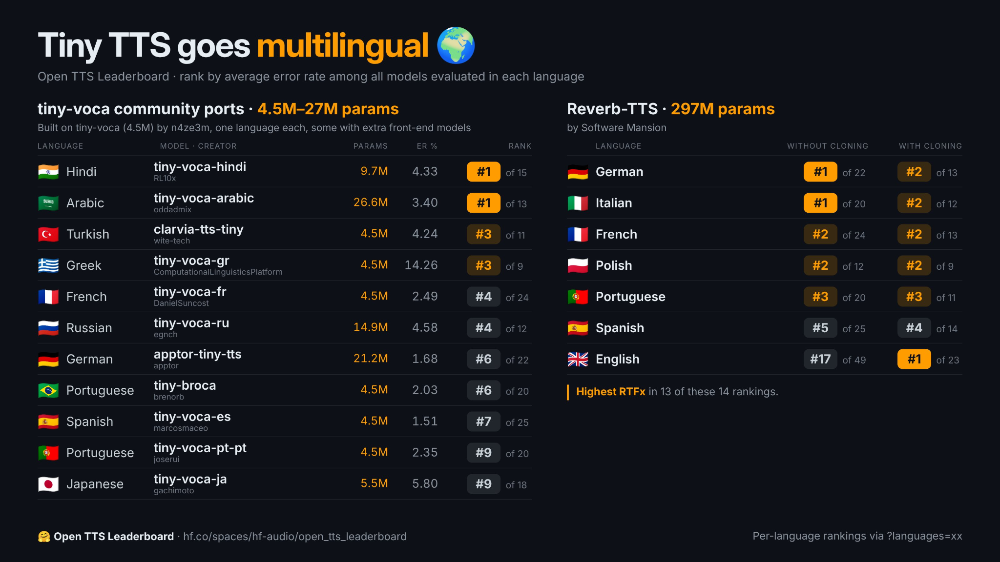

**tiny-broca** é minha adaptação do tiny-voca para português brasileiro. O modelo tem 4,5 milhões de parâmetros, incluindo o gerador de áudio, e produz fala a 24 kHz em duas vozes. Ele roda em CPU, e a [demonstração](https://tiny-broca-demo.pages.dev/) faz tudo no navegador. A [v1](https://huggingface.co/brenorb/tiny-broca/tree/v1) tem cerca de 21,4 MB em ONNX e 18,2 MB em PyTorch.

Treinei a [v0](https://huggingface.co/brenorb/tiny-broca/tree/v0) do zero com cerca de 17 horas de fala sintética gerada com Qwen3-TTS, após controle de qualidade. A v1 mantém as duas vozes e acrescenta 30 mil passos de treinamento em um conjunto corrigido e ampliado, com 28,2 horas de áudio. A [nova versão](https://github.com/brenorb/tiny-broca/blob/v1/docs/v1.md) também lê melhor números, datas, símbolos, siglas e abreviações. O código, os pesos, o conjunto de dados e a receita de treinamento estão abertos.

A v0 ficou em **6º lugar entre 20 modelos** na avaliação de português sem clonagem de voz do [Open TTS Leaderboard da Hugging Face](https://huggingface.co/spaces/hf-audio/open_tts_leaderboard?languages=pt), com taxa de erro média de 2,03%. Eric Bezzam (Hugging Face) [mencionou o projeto](https://x.com/EricBezzam/status/2125149984827818383) entre as adaptações do tiny-voca feitas pela comunidade para outros idiomas.

{: loading="lazy" decoding="async" }

*Open TTS Leaderboard da Hugging Face, na [publicação de Eric Bezzam](https://x.com/EricBezzam/status/2125149984827818383).*

Em um [benchmark independente](https://github.com/ngelik/tts-bench/blob/61c3a4fc0ac69b9ee40bf0afd63a6292d549d135/reports/tiny-broca/overview.md), a v0 gerou cerca de 25 minutos e 30 segundos de áudio em 79 segundos, na mediana de três medições após o aquecimento. O teste rodou no Chrome em um MacBook Pro com M1 Pro, usando uma só thread da CPU via WebAssembly.

### Links
[Demonstração](https://tiny-broca-demo.pages.dev/){: .btn .btn-info}
[GitHub](https://github.com/brenorb/tiny-broca){: .btn .btn-info}
[Modelo e pesos](https://huggingface.co/brenorb/tiny-broca){: .btn .btn-info}
[Conjunto de dados](https://huggingface.co/datasets/brenorb/tiny-broca){: .btn .btn-info}
